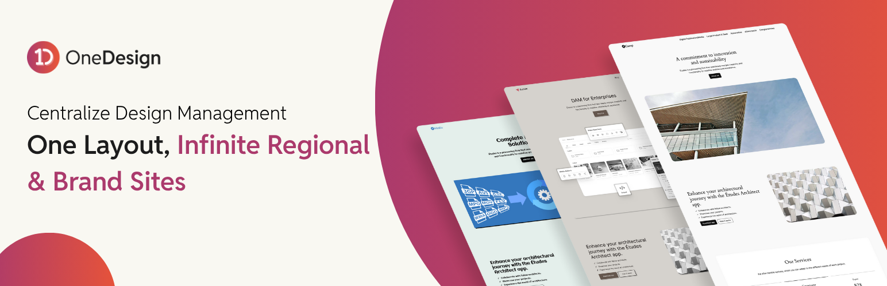

# OneDesign 

**Contributors:** [rtcamp](https://profiles.wordpress.org/rtcamp), [parthnvaswani](https://github.com/parthnvaswani), [up1512001](https://github.com/up1512001), [singhakanshu00](https://github.com/singhakanshu00), [danish17](https://github.com/danish17), [aviral-mittal](https://github.com/aviral-mittal), [vaishaliagola27](https://github.com/vaishaliagola27), [rishavjeet](https://github.com/rishavjeet), [vishal4669](https://github.com/vishal4669), [iamimmanuelraj](https://github.com/iamimmanuelraj), [vishalkakadiya](https://github.com/vishalkakadiya)

**Tags:** OnePress, OneDesign, Block patterns, Templates, Pattern sync, WordPress multisite, Site Editor

**License:** [GPL v2 or later](http://www.gnu.org/licenses/gpl-2.0.html)

> **OneDesign** is a [OnePress](https://rtcamp.com/onepress/) ecosystem plugin that syncs **block patterns and templates** across WordPress sites. You build them on one governing site and apply them to your brand sites from there.

---

## 🧠 What is OneDesign?

**OneDesign** is part of the **OnePress ecosystem**. You build block patterns and templates on one **governing site** and apply them to your **brand sites**, so every site in your network starts from the same designs. It works with a multisite network and with standalone sites.

---

## 💡 Why OneDesign?

When each brand, region or language has its own site, the same layouts tend to get rebuilt on every one of them, and they drift apart over time. **OneDesign** lets you build a pattern or template once and send it to the sites that need it.

### Benefits

- **Efficiency Multiplier**: Save up to 50% of design time by eliminating redundant pattern creation across multiple sites

- **Brand Integrity Guardian**: Prevent design drift and maintain consistent branding across your entire network

- **Operational Cost Reduction**: Reduce staff hours and simplify workflows with centralized pattern management

- **Design Governance**: Control which patterns can be used across sites with granular distribution permissions

- **Scalable Growth**: Connect unlimited sites without multisite limitations or hosting constraints.

- **Workflow Optimization**: Centralize pattern creation while maintaining individual site autonomy

### Key Features

- **Dual Architecture Support**: Works with both WordPress multisite networks and standalone WordPress installations

- **Secure API Integration**: REST API with unique authentication keys for safe cross-site pattern transfer

- **Intuitive Pattern Browser**: Full-screen admin interface with search, filtering, and live pattern previews

- **Batch Operations**: Deploy multiple patterns across multiple sites simultaneously with bulk controls

- **Pattern Status Monitoring**: Track deployment success and synchronization across all connected sites

- **Multisite Pattern Sync**: Define patterns on the governing site and apply to multiple brand sites

- **Template Sharing & Sync**: Share complete templates between sites with automatic pattern and template part synchronization

- **Intelligent Template Sync**: Templates automatically resync when updated on the governing site, ensuring brand sites stay current

- **Pattern Management**: View and manage already applied patterns

## 🧾 Requirements

| Requirement | Version |
| ----------- | ------- |
| WordPress   | >= 6.9  |
| PHP         | >= 8.2  |

- Stored API keys are encrypted with a key derived from your WordPress salts, so rotating the salts empties them. To keep them when you rotate salts, define `ONEPRESS_ENCRYPTION_KEY` and `ONEPRESS_ENCRYPTION_SALT` in `wp-config.php`. Define them before you add any keys, or enter the keys again after you do.
- Every site needs the same block theme, with the same style variables and variations.
- Every block a pattern or template uses has to be available on the sites you apply it to.

---

## 🧰 Installation

1. Download the latest OneDesign plugin from the [GitHub releases](https://github.com/rtCamp/onedesign/releases) and install it on your WordPress sites.
2. Activate the plugin.
   For **multisite installations**, make sure to `Network Activate` the plugin.
3. Visit the `OneDesign > Settings` page to configure the Governing and Brand sites (on a multisite network, start at `Network Admin > Settings > OneDesign`).

## How It Works

### Setting Up Governing and Brand Sites

1. Install and activate the OneDesign plugin on all sites in your network
2. From the OneDesign settings, designate one site as the "Governing Site" (source of patterns)
3. Designate all other sites as "Brand Sites" (where patterns will be applied)
4. Copy the API keys generated for each Brand Site from their respective settings pages
5. In the Governing Site settings, register each Brand Site by adding:
   - Site name
   - URL
   - Logo
   - API key

### Accessing the Pattern Library

1. On your Governing Site, access the Pattern Library from the sidebar menu
2. This opens a full-page interface showing all available patterns
3. Patterns are organized by categories with vertical tabs for your registered sites

### Browsing and Applying Patterns

1. **Browsing Patterns:**
   - Navigate through pattern categories in the main view
   - Use the vertical tabs to switch between different sites
   - Use the search functionality to find specific patterns
2. **Applying Patterns:**
   - Select the patterns you want to sync by clicking on them
   - Click "Apply to Sites" to open the site selection modal
   - Choose the destination sites from the modal
   - Click "Apply Patterns" to distribute the selected patterns
3. **Removing Patterns:**
   - Access the list of applied patterns by selecting the site's tab
   - Select the patterns you want to remove
   - Click "Remove Selected Patterns"
   - Confirm the removal, and the patterns will be deleted from that site

### Working with Templates

OneDesign extends beyond patterns to support full template synchronization across your network.

1. **Sharing Templates:**
   - Navigate to the Template Library from the OneDesign menu
   - Select the templates you want to share with brand sites
   - Click "Share Templates" to distribute them across your network

2. **Automatic Pattern & Template Part Creation:**
   - When you share a template, all patterns and template parts used within it are automatically created on the brand site
   - This ensures complete design consistency without manual pattern-by-pattern synchronization

3. **Template Updates & Re-sync:**
   - If you modify a template on the governing site after it's been shared, simply re-sync it
   - Go to particular brand site tab on which you need to re-sync and click "Sync Shared Templates"
   - All changes, including updated patterns and template parts, will be pushed to connected brand sites
   - Brand sites automatically receive the latest version, maintaining consistency across your network

### Video Demo

https://github.com/user-attachments/assets/d2c4b94f-3720-422d-b996-a102156bb941

## Development & Contributing

OneDesign is under active development and maintained by [rtCamp](https://rtcamp.com).

Contributions are welcome and encouraged! To learn more about contributing to OneDesign, please read the [Contributing Guide](./docs/CONTRIBUTING.md).

For development guidelines, please refer to our [Development Guide](./docs/DEVELOPMENT.md).

## Frequently Asked Questions

### How are patterns transferred between sites?

Patterns are transferred securely via WordPress REST API, ensuring that all pattern data, including blocks and settings, are properly synchronized.

### Can I customize which patterns are available to specific sites?

Yes, you can control which patterns are applied to each brand site by managing the selections in the Pattern Library.

### Are there any limits to how many patterns I can sync?

There are no hard limits on the number of patterns you can sync, but performance may vary depending on your server resources and the complexity of the patterns.

### Can I also remove patterns from specific sites?

Yes. You are able to do that from the dashboard itself.

### Can I share complete templates instead of individual patterns?

Yes! OneDesign supports full template sharing. When you share a template, all patterns and template parts within that template are automatically created on the brand site, ensuring complete design consistency.

### What happens when I update a template on the governing site?

You can re-sync templates after making changes on the governing site. Simply select the template and use the sync function to push all updates, including modified patterns and template parts, to all connected brand sites.

### Do I need to manually sync patterns used in templates?

No. When you share a template, OneDesign automatically creates all required patterns and template parts on the brand site. You only need to share the template itself.

### Troubleshooting

1. **Patterns not showing up in the library**
   - Ensure your governing site is correctly set up
   - Check network connectivity between sites
   - Verify REST API permissions
2. **Search not working correctly**
   - The search functionality only searches pattern names
   - Ensure pattern names are descriptive and unique
3. **Pattern count incorrect**
   - This may happen if patterns are filtered incorrectly
   - Try clearing your browser cache and refreshing

## Get Involved

You can join the development and discussions on [GitHub](https://github.com/rtCamp/onedesign). Feel free to report issues, suggest features, or contribute code.
